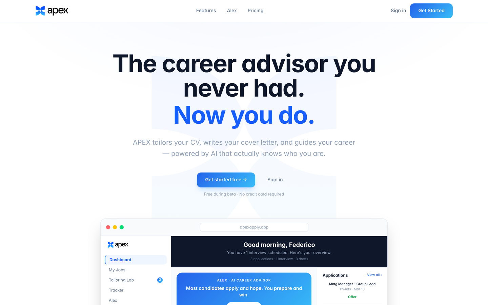
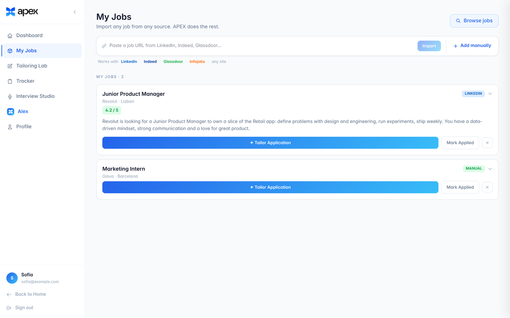
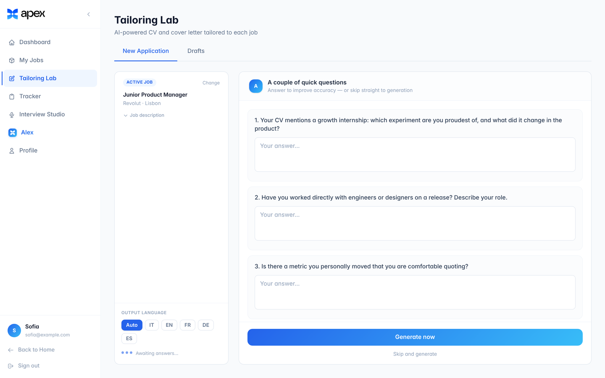
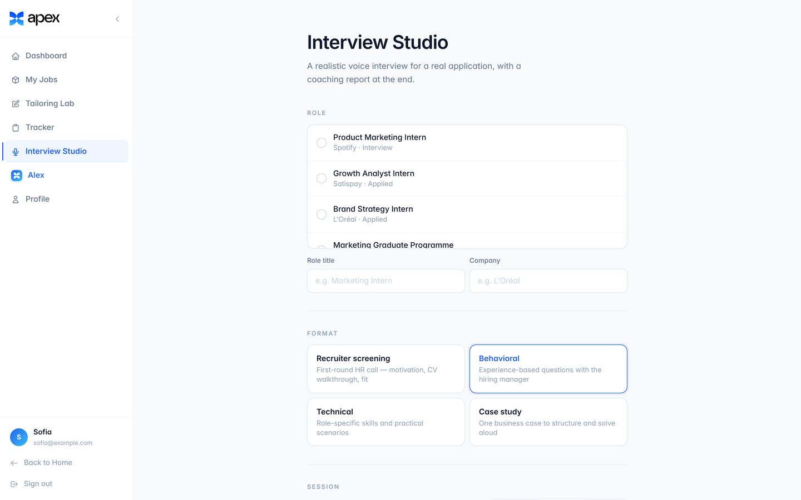
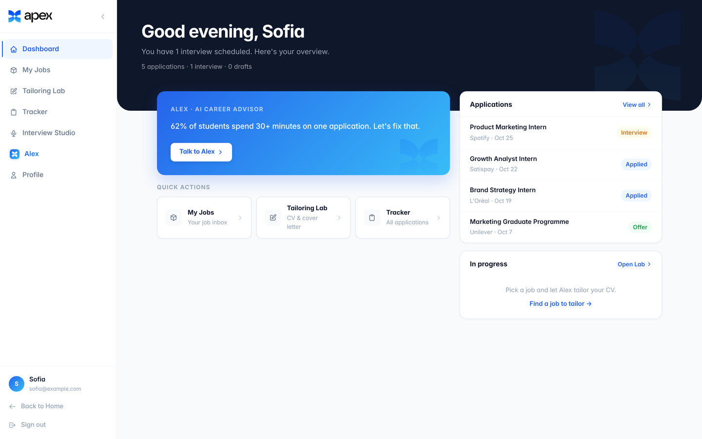
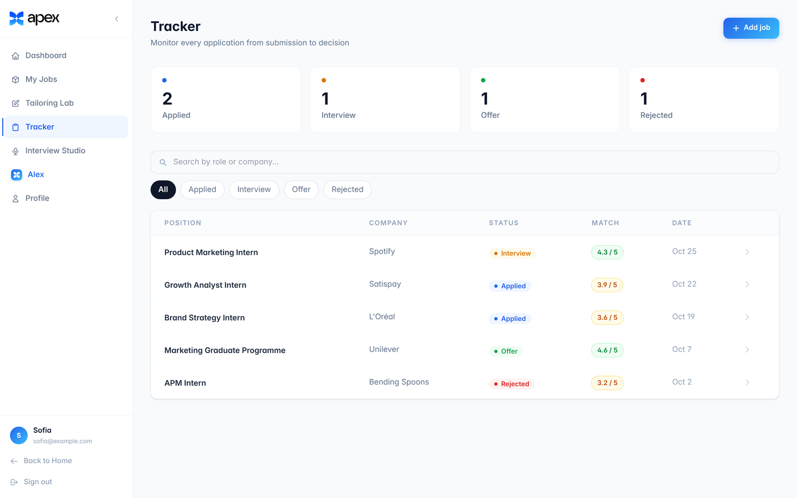
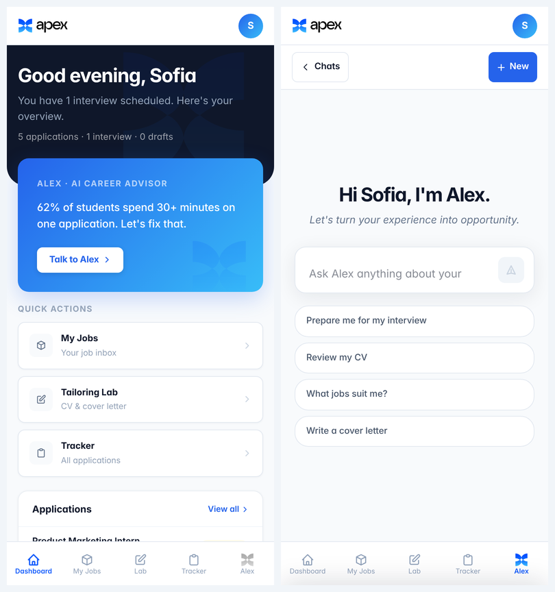

# APEX: an AI career copilot that augments the candidate instead of replacing them

**Live:** [apexapply.app](https://apexapply.app) · **Role:** solo founder: research, product design, UX/UI, build · **Timeline:** Mar 2026 – present

---

## The problem

Students applying for internships and graduate roles spend a lot of time rewriting the same CV and cover letter for every posting. Many of them never get feedback on what an interviewer is actually looking for. The usual AI shortcut, "paste the job, get a cover letter", makes things worse: recruiters spot generic text immediately, and candidates end up sending applications that don't sound like them.

**Who it's for:** university students and recent graduates in Europe applying to competitive internships and graduate programmes.

## Research

APEX started as the case study of my bachelor's thesis, *"AI agents and the future of career communication: the case of APEX"* (IULM, 2026). The research had three parts:

- **A survey of European students:** 139 responses, 108 qualified. It looked at how students write applications today, where they get stuck and how they feel about AI help.
- **12 semi-structured interviews** with people on every side of hiring: HR, university career services, AI engineers, a legal expert and investors.
- **The product itself,** used as a live case study.

**The key finding:** everyone accepted AI as a *support*, and everyone rejected AI as a *substitute*. Recruiters don't mind that a candidate used AI. They mind when the application no longer sounds like the person who sent it.

## The design principle

> **Augment the candidate's voice, never replace it.**

Every design decision in APEX follows from this one rule:

| Decision | Why |
|---|---|
| **The Tailoring Lab asks before it writes.** It first asks up to 3 clarifying questions about the candidate's real experience, and only then generates anything. | Tailoring with missing facts produces generic text or invented claims. Asking keeps the candidate in the loop and the output grounded. |
| **"Never invent" is a hard rule** in every model prompt. No employer, number, skill or result appears unless the candidate provided it. | An invented credential can't be defended in an interview. Credibility comes from the process, not from polished wording. |
| **Every rewrite shows what changed and why**, in a changelog next to the tailored CV. | Candidates can learn from the edits and keep authorship of the final document. |
| **The Interview Studio coaches; it doesn't script.** It runs a live spoken mock interview, and a separate feedback agent writes the coaching report. | Practising in your own words builds the skill. A memorised script falls apart under follow-up questions. |

## The experience

**1. Bring any job in.** Paste a link from LinkedIn, Indeed, Glassdoor or any other site, or add the job manually. APEX imports it and scores how well it matches the candidate's profile.

**2. Tailor, together.** Before generating anything, the Tailoring Lab asks the candidate what it needs to know. They can answer, or skip straight to generation. The output language can be chosen or detected from the posting automatically.

**3. Practise the interview out loud.** Pick the application and the format (recruiter screen, behavioral, technical or case study). A research agent briefs the interviewer on the company, the candidate speaks their answers, and the session ends with a coaching report.

**4. Keep the whole search in one place.** The dashboard and tracker follow every application from submission to decision. Alex, the AI career advisor, is available on every page.

**Mobile-first where it matters.** Students check applications on their phones, so the app has its own mobile layout. Navigation moves to a bottom bar, Alex opens as a bottom sheet, and the job list uses drawers instead of side panels.

## How it evolved

APEX shipped in small iterations; the commit history has 50 commits. The changes that mattered most for the experience:

- **One-shot generation → a two-step flow.** First clarifying questions, then generation. This is the core expression of the design principle.
- **Search-based job discovery → "import any job from anywhere".** Students already find jobs on LinkedIn and on company sites. Import now tries several methods in turn and falls back to pasting the posting by hand.
- **One onboarding path → three.** You can start with a CV, with a LinkedIn PDF, or with no CV at all, in which case a guided set of questions builds one.
- **A separate mobile redesign.** It covers the bottom navigation, the Alex bottom sheet and the drawer pattern for job suggestions.
- **Italian, plus a language picker.** Italian opened up the home market, and the picker lets candidates write in the language of the posting.
- **Analytics (PostHog) to measure real use** before investing further.

## Status and what I learned

APEX has not been publicly launched yet. A small group of students and I use it for real applications.

Three things I'd take into any product team:
1. **Research gives you the rules, not the features.** The thesis didn't tell me what to build. It told me what the product must never do, and that turned out to be more useful.
2. **The most important UX moment is often a pause.** Asking three questions before generating makes the output better *and* gives the user ownership of it.
3. **Ship, then cut.** Several features (job search APIs, single-path onboarding) were replaced once real use showed what people actually did.

---

<strong>Tech notes</strong>

- **Front end:** React + Vite, Tailwind CSS v4, Framer Motion.
- **Back end:** Vercel serverless functions (`/api`) and Supabase (auth, Postgres with row-level security, free-plan limits enforced on the server).
- **AI:** a multi-agent LLM system. Alex is an orchestrator with research and review sub-agents. The Interview Studio uses a research agent, a low-latency interviewer agent and a feedback agent. Every prompt change is logged with its rationale in [`PROMPT_NOTES.md`](PROMPT_NOTES.md).
- **Running locally:** copy `.env.example` to `.env.local`, fill in the keys, then run `npm install && npm run dev`.

